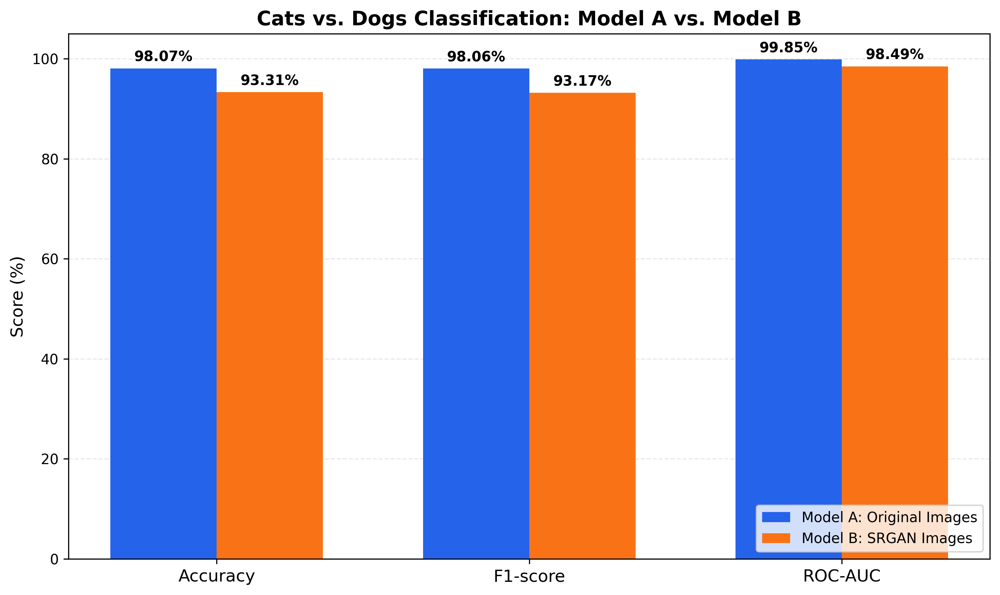
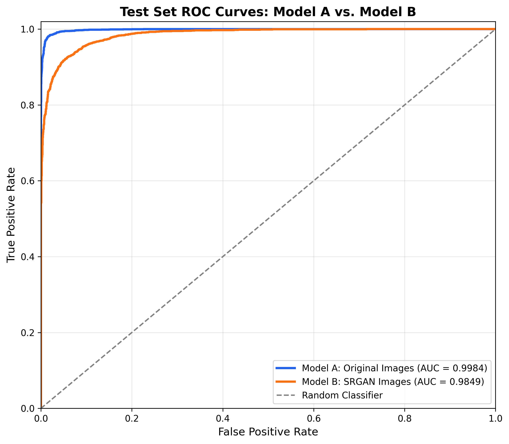
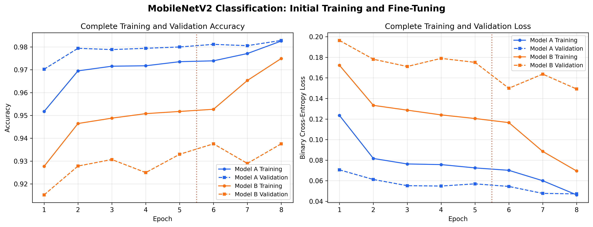
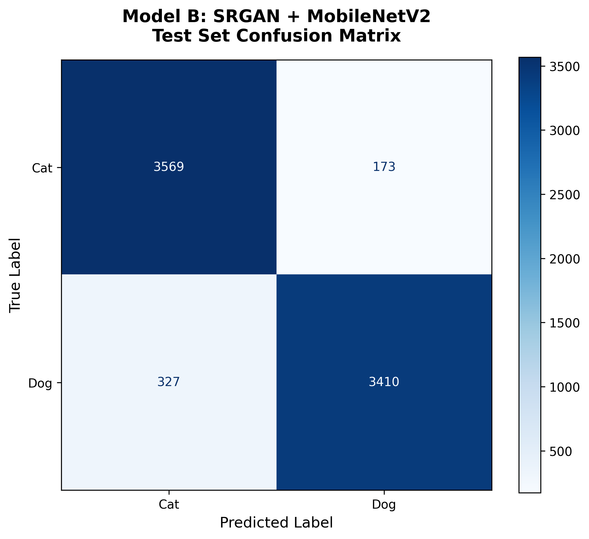
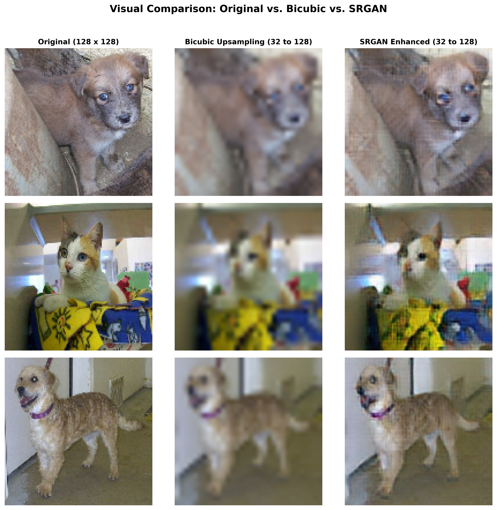

# Applied AI Midterm: Cats vs. Dogs Classification Using MobileNetV2 and SRGAN

## Project Overview

This project investigates whether image enhancement using a Super-Resolution Generative Adversarial Network (SRGAN) improves image classification performance.

Two MobileNetV2-based binary classifiers were trained and evaluated:

- **Model A:** MobileNetV2 trained on original 128 × 128 images.
- **Model B:** MobileNetV2 trained on SRGAN-enhanced images, generated by downsampling images to 32 × 32 and reconstructing them to 128 × 128.

Both classifiers were evaluated using the same held-out test set.

## Dataset

The project uses a cats-versus-dogs image dataset with the following classification labels:

- Cat: 0
- Dog: 1

The dataset was prepared and divided into:

| Dataset Split | Number of Images |
|---|---:|
| Training | 15,705 |
| Validation | 1,746 |
| Test | 7,479 |
| **Total** | **24,930** |

Dataset preparation, verification, and split information are documented in the project notebooks and CSV files.

The split CSVs contain file paths from the original Colab/Kaggle environments. Those paths must be adapted when reproducing the experiment in a different environment.

## Methodology

### Model A: Original-Image Classification

Model A uses MobileNetV2 with pretrained ImageNet weights as a feature extractor and a binary classification head.

The architecture includes:

- Input image size: 128 × 128 × 3
- MobileNetV2 pretrained backbone
- Global average pooling
- Dropout (0.2)
- Dense output layer with sigmoid activation

Training was performed in two stages:

1. Initial transfer learning: 5 epochs
2. Fine-tuning: 3 epochs using Adam with a learning rate of 0.00001

### SRGAN Image Enhancement

SRGAN was trained to reconstruct high-resolution images from low-resolution inputs.

- Low-resolution input: 32 × 32
- Super-resolved output: 128 × 128
- Upscaling factor: 4
- Completed SRGAN training: 150 epochs

SRGAN training used a generator, discriminator, and a combined reconstruction objective incorporating pixel, perceptual, and adversarial components.

Image reconstruction quality was evaluated using Peak Signal-to-Noise Ratio (PSNR) and Structural Similarity Index (SSIM), with bicubic interpolation as a comparison baseline.

| Image Reconstruction Method | PSNR (dB) | SSIM |
|---|---:|---:|
| Bicubic interpolation | 23.1046 | 0.6402 |
| SRGAN (150 epochs) | **23.1975** | **0.6435** |

These measurements were obtained from the evaluated validation sample and indicate a modest improvement in image reconstruction quality.

### Model B: SRGAN-Enhanced Classification

Model B uses the same MobileNetV2-based classification architecture as Model A.

Its input images were produced by:

1. Resizing the original images to 128 × 128.
2. Downsampling them to 32 × 32.
3. Applying the trained SRGAN generator to reconstruct 128 × 128 images.
4. Using the reconstructed images for binary classification.

Model B was trained for:

- Initial transfer learning: 5 epochs
- Fine-tuning: 3 epochs
- Fine-tuning learning rate: 0.00001
- Training batch size: 16

The SRGAN generator was frozen during classifier training.

To accelerate fine-tuning, SRGAN-enhanced images were cached after initial training and reused rather than regenerated for every epoch.

## Final Test Results

Both classifiers were evaluated on the same 7,479-image test split.

| Metric | Model A: Original Images | Model B: SRGAN Images |
|---|---:|---:|
| Accuracy | **98.07%** | 93.31% |
| Precision | **98.80%** | 95.17% |
| Recall | **97.32%** | 91.25% |
| F1-score | **98.06%** | 93.17% |
| ROC-AUC | **0.99847** | 0.98489 |

Model A achieved approximately **4.76 percentage points higher test accuracy** than Model B.

Model A was also evaluated again using its saved checkpoint to recover individual prediction probabilities for a combined ROC curve. This recovered evaluation produced an accuracy of 98.03% and ROC-AUC of 0.998392, a small difference from the original results. The original evaluation values are retained in the results table, while the combined ROC curve uses the recovered probabilities.

## Visualizations

### Classification Performance

### Combined ROC Curves

### Complete Training Curves

### Model B Confusion Matrix

### SRGAN Image Comparison

## Discussion

SRGAN achieved slightly higher PSNR and SSIM than bicubic interpolation for the evaluated image sample, indicating improved reconstruction quality according to these metrics.

However, Model B performed worse than Model A on the classification task. This suggests that improved image reconstruction quality does not necessarily translate into improved downstream image classification.

A possible explanation is that the downsampling and reconstruction process changes or removes discriminative visual information. SRGAN may also introduce reconstructed textures that do not match the original image features.

These explanations remain hypotheses and would require further experiments to confirm.

Model B also exhibited a larger gap between training and validation performance during fine-tuning, suggesting reduced generalization compared with Model A.

## Repository Contents

- `01_Colab_Data_Preparation_and_Model_A.ipynb` — Earlier work completed in Google Colab.
- `02_Kaggle_SRGAN_Training_and_Model_B_Evaluation.ipynb` — Subsequent experiments completed in Kaggle.
- `data_pipeline.py` — Dataset preparation utilities.
- `srgan_models.py` — SRGAN model definitions.
- `Scripts/` — Additional exported Kaggle Python source.
- `Figures/` — Experimental figures and visualizations.
- `model_A_test_results.csv` — Original Model A evaluation metrics.
- `model_b_test_metrics.csv` — Model B evaluation metrics.
- `model_a_test_predictions.csv` — Recovered Model A test predictions.
- `model_b_test_predictions.csv` — Model B test predictions.
- `final_model_comparison.csv` — Summary comparison of classifier performance.
- `srgan_training_history.csv` — SRGAN training history.
- `srgan_final_quality_metrics.csv` — PSNR and SSIM evaluation.
- `model_train_split.csv`, `validation_split.csv`, `test_split.csv` — Dataset split records.

## Reproducibility

The experiments were developed in Google Colab and Kaggle using Python and TensorFlow/Keras.

The notebooks provide the implementation and experimental sequence. Reproducing the results requires:

1. Access to the original cats-versus-dogs dataset.
2. TensorFlow/Keras, NumPy, pandas, scikit-learn, Matplotlib, and supporting image-processing libraries.
3. Updating dataset paths and notebook environment-specific directories.
4. Executing the data preparation and Model A workflow.
5. Training SRGAN for 150 epochs or restoring a compatible saved checkpoint.
6. Generating SRGAN-enhanced images and training Model B.
7. Evaluating both models on the same held-out test split.

Large training checkpoints, cached images, and original image datasets are excluded from the GitHub repository because of their size. The notebooks, training histories, metrics, predictions, and figures are provided to document the completed experiments.

The exported notebooks record the interactive research workflow; environment-specific paths and intermediate setup steps may require adjustment before a clean rerun.

## Conclusion

The experiment demonstrated that SRGAN can modestly improve quantitative image reconstruction quality while still reducing downstream classification performance relative to using original images.

For this dataset and training setup, **MobileNetV2 trained directly on the original images was the better classification approach**, achieving 98.07% test accuracy compared with 93.31% for MobileNetV2 trained on SRGAN-enhanced images.

This highlights the importance of evaluating image enhancement methods not only through perceptual and reconstruction metrics but also through performance on the intended downstream task.
